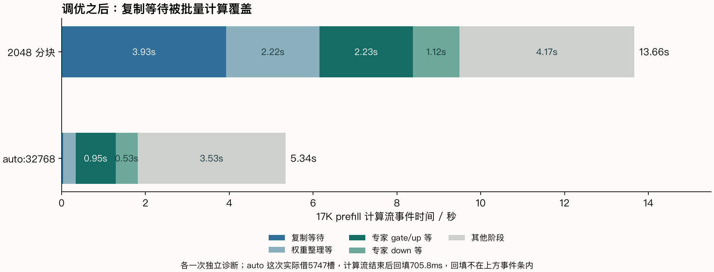
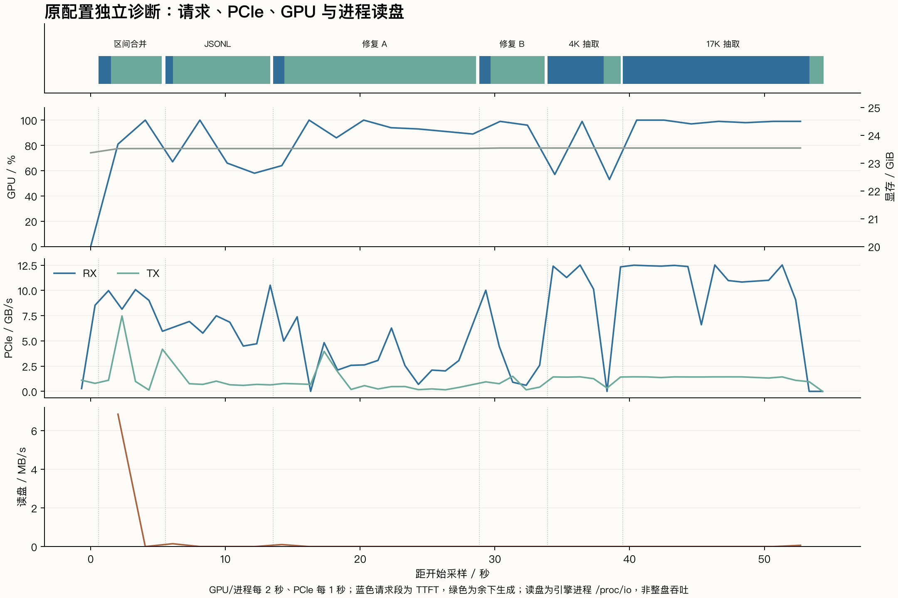

# RTX 3090 解锁后的 Strata 性能报告

> 后续更新：同配置两端320请求与decode分析已完成，新增结果见[分阶段对照](followup-evidence/limits/index.html)、[decode拆分](followup-evidence/decode/index.html)及[研究清单](RESEARCH-QUESTIONS.md)。本页保留此前240请求调优实验。

本轮峰值配置为 **prefill auto:32768 / PCIe份额1.0 / MTP4**，三次独立启动、每次两轮六任务，合计 **36/36**。17K TTFT中位数 **5.952秒**，相对解锁后原2048配置的13.486秒减少 **55.9%**；prefill **2933 token/s**。

日常配置选择 **prefill18432 / PCIe1.0 / MTP4**：两次独立启动共 **23/24**，17K TTFT **5.960秒**，loaded后可用内存约8GiB、专家RAM副本全部锁页。auto:32768可用内存约1.6GiB，保留为峰值对照。

硬件解锁的独立收益来自前一轮同配置72请求：8192³ FP16/FP32累加76.65→122.34TFLOPS；Strata原配置17K TTFT13.928→13.486秒，减少3.2%。后续的大幅缩短来自已解锁状态下的配置调整。默认启动项复核仍测得122.35TFLOPS，直通GPU跨虚拟机重启保留了解锁状态，因此本轮未形成“未解锁+新配置”组。

本轮新增240个请求，其中216个速度/质量请求、24个独立诊断；加此前72请求，共312个对照与诊断请求。预热和最终服务短对话另计。

## 同一台机器与固定条件

Xeon Platinum8260、32vCPU，guest可见AVX2/无AVX512，一个NUMA节点；可见RAM62.76GiB，RTX3090 24GiB，负载PCIe Gen3×16。Ubuntu22.04、5.15.0-161、580.126.09、CUDA12.8、350W。

Strata0.1.43固定7695859aa13afb248bdb4d36f9b2e95707db079d；引擎SHA256为560cb9df5cbc3fa3fa59a7c749fed7514935ed245e6fd85db75d1f79baa37944，sm_86。ModelScope两片IQ2_XS与原实验校验一致。每次启动恢复同一初始expert profile；temperature0、seed20261013、reasoning none、单请求；32K/int8KV、PLE RAM、resident-experts、18GiB/13432槽、7workers；tail skip0、prefill CPU share0，无前缀/会话缓存。MTP8筛选少一个槽，实际日志保留。

TTFT计到首个可见content，E2E计到SSE结束；吞吐为引擎计时。加载和16-token预热另计，首个真实任务仍保留在数据中。原配置与峰值每任务6次；日常候选每任务4次；筛选每任务2次。诊断单列。

## 固定负载的结果

| 配置 | 每任务次数 | 4K TTFT / s | 4K prefill / token/s | 17K TTFT / s | 17K prefill / token/s | 六任务通过 |
|---|---:|---:|---:|---:|---:|---:|
| 未解锁 / 原2048配置 | 6 | 4.187 | 1056.0 | 13.928 | 1249.5 | 34/36 |
| 解锁 / 原2048配置 | 6 | 4.079 | 1084.0 | 13.486 | 1290.2 | 34/36 |
| 解锁 / auto:32768 峰值对照 | 6 | 2.218 | 2005.0 | 5.952 | 2933.0 | 36/36 |
| 解锁 / 18432 日常候选 | 4 | 2.216 | 2009.5 | 5.960 | 2929.1 | 23/24 |

| 任务 | 原配置 → 峰值 decode / token/s | 原配置 → 峰值 E2E / s | 输出 token 中位数 | 通过 |
|---|---:|---:|---:|---:|
| 区间合并 | 58.2 → 70.5 | 3.633 → 3.183 | 160 → 160 | 6/6 → 6/6 |
| JSONL 汇总 | 78.8 → 96.0 | 7.069 → 5.895 | 509 → 509 | 6/6 → 6/6 |
| 退避修复 A | 102.4 → 115.2 | 14.902 → 13.105 | 1420 → 1420 | 5/6 → 6/6 |
| 退避修复 B | 106.8 → 121.8 | 4.771 → 4.268 | 427 → 427 | 5/6 → 6/6 |

修复A/B均为指数退避函数的溢出修复，使用两份固定的首答历史和相同报错反馈，输出预算2048；测试覆盖类型、零值、base>cap、10000次等边界。长输入分别为4392/17352 token，五字段字典精确匹配。区间合并和JSONL为独立函数任务。18432唯一失败为第二次启动、第二轮修复B的10000次用例OverflowError；回答以stop结束，15项测试14项通过。温度0仍观察到不同输出，全部样本逐次评分并保留。

峰值配置中通过测试的最高单次decode为124.4token/s：修复B、427输出token、E2E4.205秒。短请求TTFT有首轮波动，区间合并六次范围0.509–2.042秒；17K范围5.922–5.977秒。逐请求保留输出长度和结束原因。

## 从观测选择参数

| 配置，PCIe份额1.0 | 4K TTFT / s | 17K TTFT / s | 通过 |
|---|---:|---:|---:|
| 2048 / 默认MMQ | 4.081 | 13.486 | 12/12 |
| 2048 / FP16专家 | 4.300 | 14.180 | 9/12 |
| 2048 / 融合IQ | 4.106 | 13.536 | 11/12 |
| 4096 | 3.095 | 9.203 | 12/12 |
| 8192 | 2.216 | 7.563 | 12/12 |
| 4096 / 融合IQ | 3.139 | 9.353 | 9/12 |
| 18432 | 2.216 | 5.960 | 12/12 |
| auto:32768 | 2.224 | 5.952 | 12/12 |

FP16路径实际切换到逐专家反量化与cuBLAS，4K/17K均稍慢，修复通过较少；融合IQ日志确认生效，在2048/4096下未优于相同分块默认路径。2048、4096、8192、18432都关闭prefill CPU分担，分块比较保持该分工一致。

| PCIe份额，prefill8192 | 区间合并 E2E / s | JSONL E2E / s | 修复 A / B 通过 |
|---|---:|---:|---:|
| 1.0 | 3.533 | 6.836 | 2/2、2/2 |
| 0.75 | 3.133 | 6.238 | 1/2、1/2 |
| 0.5 | 3.273 | 6.225 | 2/2、0/2 |
| 0.25 | 3.098 | 6.061 | 1/2、0/2 |

0.5份额的修复B decode为131.7token/s、E2E11.13秒、0/2通过；1.0为110.7token/s、4.62秒、2/2通过。前者一次2048token截断，一次保存代码复评耗尽5秒CPU预算；保留原评分与资源复评。日常和峰值配置均保留1.0。

| MTP 窗口，prefill2048 / PCIe1.0 | JSONL decode / token/s | JSONL E2E / s | 六任务通过 |
|---|---:|---:|---:|
| 2 | 71.7 | 7.716 | 12/12 |
| 4 | 78.9 | 7.058 | 12/12 |
| 6 | 77.6 | 7.220 | 10/12 |
| 8 | 73.7 | 7.604 | 10/12 |

更大MTP窗口未获得稳定整体优势，本轮保留4。未修改模型量化、KV格式或尾部专家计算来换取吞吐。

## 分项与瓶颈变化

原2048配置17K独立诊断：计算流13.660秒，其中复制等待3.927秒、权重整理等2.221秒、专家gate/up等2.230秒、down等1.116秒。GPU利用率中位数96%，PCIe RX秒级峰值12.525GB/s；长输入读盘很少。

auto:32768的17K诊断：计算流5.339秒，复制等待0.037秒、权重整理等0.296秒、专家乘法等1.480秒；实际借5747槽，结束回填705.8ms，客户端TTFT6.113秒。增大批量减少反复遍历专家，让复制与计算重叠；新的耗时重点是计算和结束回填。

JSONL的独立verify profile在32.54ms/window分段中记录waitB15.33ms。该模式关闭部分融合/并发，单列定位；阶段值与常规速度分开。默认prefill的dequant标记也包含MMQ权重gather/格式整理，连续event间隔包含等待。

## 显存与RAM预算

| 上限 | 最大借用槽 / GiB | RAM专家副本 / GiB | loaded后MemAvailable / GiB |
|---|---:|---:|---:|
| 2048 | 861 / 1.15 | 16.17 | 15.47 |
| 8192 | 2812 / 3.77 | 18.79 | 12.72 |
| 18432 | 6072 / 8.14 | 23.16，全部锁页 | 8.05 |
| auto:32768 | 10652 / 14.25 | 29.26，其中29.00锁页 | 1.61 |

PLE另占26.82GiB。表为配置预算；每次请求按实际token数借用，验证前回填原槽。短请求不会直接借满32768预算。大上限额外保留更多GPU槽的RAM副本；预算边缘出现少量未保留和未锁页数据。18432在17K输入上保留相近速度与更大的可用内存。

## 启动回退与最终服务

默认重启不带targets，本次启动无解锁成功行；8192³仍为122.3506TFLOPS，六组完整输出与先前解锁一致。再进解锁项时返回-114；固定源码该分支可对应PLM已打开/卡并非冷态，随后GEMM仍为122.3484TFLOPS。原版引导配置与未解锁硬件状态需要分别核对；新的未解锁调优组需宿主机层面恢复初始卡状态后再测。

已保留配置与启动器备份，并将日常prefill设为18432。最终health loaded=true、短对话完成、slot空闲，可用内存8.02GiB；服务继续监听loopback。驱动、量化、尾部策略、KV和输出预算保持原设置。

## 后续验证与复现

本轮已覆盖浮点/量化专家路径、融合路径、分块、MTP窗口、CPU/PCIe份额、内存预算和跨启动确认；“最优”指这六类固定负载及已测配置中的选择。更大上下文、持续多轮仓库开发和冷复位后的同配置未解锁组可沿用本目录脚本。HumanEval+/Polyglot完整题集的旧分数保留在前篇，本轮使用上述六类任务进行回归。

[逐请求CSV](requests.csv) · [汇总JSON](summary.json) · [完整性审计](audit.json) · [源码核对](SOURCE-MAP.md) · [复现说明](REPLAY.md) · [博客正文](https://hanayo.cn/2026/10/27/strata-3090-unlock-decode/)
