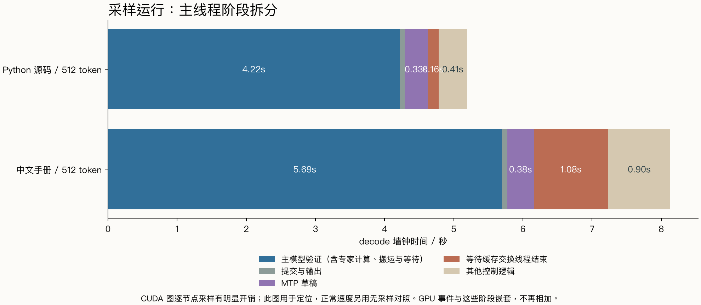
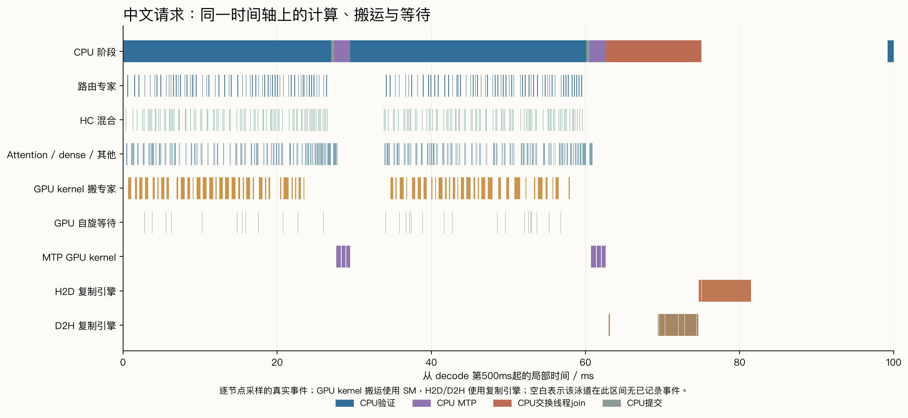
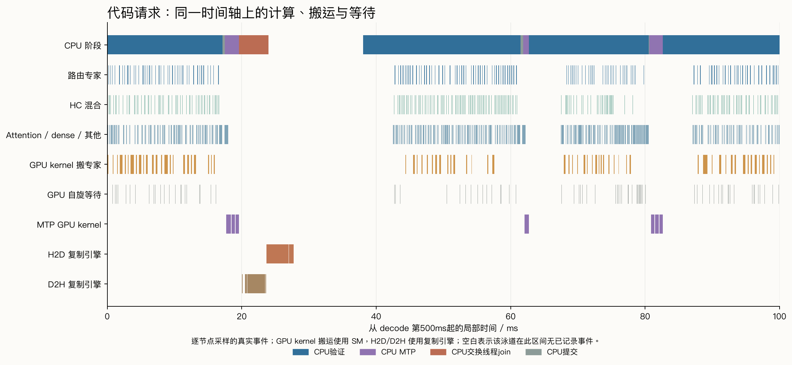

# 3090 上的 Strata decode：专家计算、搬运、等待与 MTP

本轮把正常速度测试、CUDA 图逐节点采样、图级采样和引擎分段计时分开记录。较明确的开销来自映射主机权重的 GPU 搬运，以及专家缓存交换的复制、等待与提交；MTP 草稿本身占主线程 decode 时间约 5–6%。参数调整得到小幅收益，尚未得到稳定的大幅提速。

## 环境与测法

RTX 3090 24GiB / 350W，Xeon Platinum 8260 / 32 vCPU，系统可见约62.76GiB RAM，PCIe Gen3×16；580.126.09 / CUDA12.8。GPU维持软件恢复的原始性能选择寄存器状态。Strata0.1.43，原引擎SHA256 `560cb9df5cbc3fa3fa59a7c749fed7514935ed245e6fd85db75d1f79baa37944`，源码按既有固定提交 `7695859aa13afb248bdb4d36f9b2e95707db079d`。

固定两个短输入：连续Python源码、中文数据库手册，实际prompt为71/70 token，每请求生成512 token。32K/int8KV、MTP4、7个专家线程、PCIe份额1、CPU prefill份额0、尾部跳过关闭、prefill2048，无前缀/对话缓存；每次独立启动恢复同一专家画像，预热两份512-token回答，再做两轮测量。它们用于速率与路径分析，本轮未新增编码正确率评分。

正常原引擎的专家缓存为13432槽/18.00GiB。Nsight与标记构建会占额外显存，实际缓存容量见各组environment.json；它们用于归因，速度收益采用无采样的原引擎对照。

Nsight Systems2024.6.2；逐节点采样的decode耗时较采样关闭时增加约23%至38%。NVTX构建仅增加请求、verify、commit/emit、MTP、adapt_join标记，独立链接，原源码与原引擎保持。后续图级采样用于核对较低采样开销和请求收尾。

## 先分开两个时间层次

主线程的verify包含GPU计算、搬运及等待；GPU事件是它内部的活动。下面两张表分别解释墙钟时间与GPU活动，不能跨表求和。

|逐节点采样，512 token|代码|中文|
|---|---:|---:|
|主模型验证|4.217s|5.692s|
|提交与输出|0.073s|0.082s|
|MTP草稿|0.331s|0.383s|
|等待交换线程结束|0.160s|1.077s|
|其他控制逻辑|0.409s|0.896s|
|decode合计|5.190s|8.130s|

“等待交换线程结束”来自源代码中对adapt_thr的join标记；其他控制逻辑还包括下一窗口准备、pending交换提交与lookup等，未全部归入缓存交换。CPU端GPU-reach wait嵌在verify里，其数值包含GPU推进过程。

|同一采样运行内的GPU活动，区间并集|代码|中文|
|---|---:|---:|
|路由专家gate/up/down kernel|0.663s|0.783s|
|HC混合kernel|0.671s|0.807s|
|Attention、dense及其他（含共享专家通用投影）|1.527s|1.868s|
|MTP内GPU kernel|0.255s|0.297s|
|映射权重的GPU搬运kernel|0.599s|1.198s|
|flag自旋kernel|0.179s|0.232s|

不同GPU类别可并发，类别区间并集也不构成严格的墙钟时间分割。HC来自fused_gr.cu，负责Hyper-Connection读/混合；共享专家的矩阵投影复用通用MMVQ，未仅凭kernel名字硬拆。引擎独立分段计时中，shared+quant约1.10ms/window（代码）、1.08ms/window（中文），仅作辅助参考；该模式关闭部分融合和共享专家并行。

## PCIe同时有两条路径

默认auto在本构建中选pcie_mode=2。CPU发布主机映射地址，GPU在verify流上执行fetch_blobs，把未驻留专家搬到暂存区，再计算。CUDA复制引擎的H2D/D2H记录另含缓存热冷交换等活动，因此仅看cudaMemcpy会漏掉GPU kernel发起的PCIe读。

|decode区间内复制引擎|代码|中文|
|---|---:|---:|
|H2D字节量|1.222GB|2.696GB|
|H2D区间并集耗时|0.104s|0.230s|
|D2H字节量|1.125GB|2.459GB|
|D2H区间并集耗时|0.088s|0.191s|

这些是decode范围内的复制记录，已排除前面的prompt；仍不等于PCIe全部字节量。resident_stage_swaps先把将被逐出的专家从GPU读回RAM缓冲，等该轮读回完成，再安排热专家入GPU；apply_pending提交更新。当前采样中这些复制未与已记录的数学kernel重叠，诊断局部如下。

## 纯flag等待与waitB分段

按每个verify图的48个层子图、每层三个等待节点的源码顺序，区分waitA、waitB和waitCPU；每图要求完整144个节点，分类校验见sync-classification.json。

|等待kernel的GPU区间并集|代码|中文|
|---|---:|---:|
|waitA|118.7ms|154.9ms|
|waitB|32.9ms|41.1ms|
|waitCPU|27.8ms|35.6ms|

verify.cpp在waitB后执行fetch_blobs，随后才记分段stamp21。因此内置“waitB”区间包含搬专家的kernel；中文分段约5.55ms/window，不能全部解释成flag自旋。Nsight直接记录的waitB kernel合计约41ms，搬运kernel则约1.20秒。

## 无采样对照：实际收益多大

第一轮kernel/DMA/direct筛选期间有标记构建，成绩单列为初筛。最终主要比较编译完成后的kernel→DMA及DMA→kernel反向顺序，各配置两个独立启动、每种输入共四次请求。交换周期16和resident overlap各一次启动、两轮，样本较少。

|配置|代码decode token/s|中文decode token/s|代码客户端TPOT ms|中文客户端TPOT ms|
|---|---:|---:|---:|---:|
|kernel，周期4（两个启动）|121.10|85.85|8.25|11.65|
|DMA，周期4（两个启动）|124.30|87.55|8.03|11.43|
|kernel，周期16（一个启动）|120.35|87.55|8.33|11.43|
|kernel，周期4 + resident overlap（一个启动）|124.45|87.45|9.13|11.44|

引擎decode token/s来自predicted_ms；客户端TPOT统一用(E2E−TTFT)/(512−1)，含最后内容到SSE结束的等待。DMA首个独立对照约+4%，反向顺序则接近持平；合并中位数约代码+2.6%、中文+2.0%，重复范围有重叠。它是小幅候选。

周期16的代码首轮113.4、次轮127.3 token/s，热度追踪变慢后有明显冷热取舍。resident overlap把其他控制逻辑从约3–5ms/window压到约0.7–1.1，但verify阶段的逐层等待增多，净收益只有几个百分点。其一次代码请求在最后内容后还有约1.14秒才结束；原始事件保留，不能仅按引擎token/s采用。

上述正常对照的两份512-token内容哈希逐一一致，见request-audit.json。这里验证的是这两份输出一致，本轮未新增通用代码评分。

## 最后一轮：图级采样与尾部等待

|图级采样|decode ms|MTP ms|交换线程join ms|最后内容到结束 ms|
|---|---:|---:|---:|---:|
|trace-r1-decode-0|4379.1|289.0|188.5|0.5|
|trace-r1-decode-2|6447.2|338.7|628.3|0.6|
|trace-r2-decode-0|4574.2|283.8|428.4|0.7|
|trace-r2-decode-2|6815.4|337.0|626.7|93.6|

图级采样仍有开销，且工具的显存占用改变少量缓存槽；它用于核对阶段与收尾，未纳入无采样速度排名。四次图级采样未重现1.14秒尾部等待：三次最后内容至结束约0.5–0.7ms，一次约93.6ms。后一条收尾区间内的CUDA EventSynchronize只有约0.29ms，余下时间尚不能归为GPU同步；原始客户端事件与CUDA API时间戳均保留。

## 优化结论与下一步

1. 本轮没有找到稳定的大幅decode提速开关；日常服务继续使用原配置。DMA是可继续验证的小幅候选。
2. 更具体的源码优化点是resident_stage_swaps读回/同步、apply_pending提交，以及交换与逐层计算的衔接。现有resident overlap已隐藏部分主循环外等待，但也把等待推入verify，净收益应按客户端完成时间验收。
3. GPU权重搬运、量化专家、HC及通用投影占较多活动时间。解锁增加的FP16/BF16 Tensor GEMM吞吐并非这些路径的统一加速比，后续kernel优化应依据具体算子、访存与分组形状测量。
4. MTP草稿自身约占主线程decode的5–6%，每窗口约产出2.3–2.8 token；它还改变主模型的批量形状。优先处理权重数据流和交换等待，再评价更大MTP窗口。

注意：这是短上下文、单请求、固定512-token负载。正常测量与诊断各自保留；初筛、采样与辅助分段未混入最终性能提升百分比。较长编码上下文、不同任务和并发仍需独立验证。本轮未采Nsight Compute硬件计数器，当前能定位时间开销，尚未判定每个kernel是DRAM带宽、指令吞吐还是occupancy达到上限。

## 证据与复现

- [逐请求与CPU分段CSV](bench-requests.csv)、[无采样汇总](bench-summary.json)、[请求核验](request-audit.json)。
- [CUDA事件分类](analysis-nvtx/summary.json)、[逐kernel记录](analysis-nvtx/kernel-top.csv)、[CPU范围](analysis-nvtx/cpu-ranges.csv)、[flag分类校验](analysis-nvtx/sync-classification.json)。
- 本页提供脱敏汇总与图表，原始采样和完整运行日志留在实验归档中。
- [GPU搬运与合并源码](https://github.com/Niko1221/Strata/blob/7695859aa13afb248bdb4d36f9b2e95707db079d/src/core/verify.cpp#L1570-L1640)、[缓存交换实现](https://github.com/Niko1221/Strata/blob/7695859aa13afb248bdb4d36f9b2e95707db079d/src/program/generate.cpp#L275-L320)、[Nsight采集说明](https://docs.nvidia.com/nsight-systems/UserGuide/)。
