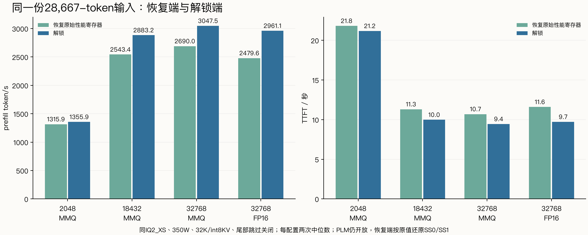
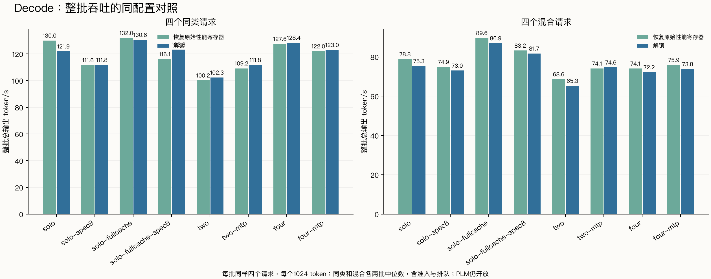

# Strata：恢复性能寄存器后与解锁端对照

恢复端使用本卡最初日志中的 SS0=0x02200115、SS1=0x4；PLM仍开放。FP16/BF16矩阵吞吐已恢复原基线，六组完整输出哈希与原始未解锁端一致。本次衡量性能选择寄存器恢复前后的速度差，恢复端并非完整物理冷启动。

同一IQ2_XS、Strata0.1.43/同引擎SHA、同350W、PCIe Gen3×16、同输入及专家画像；关闭前缀/对话缓存、尾部跳过和CPU prefill分担。每种输入/请求组合两轮；配置间速度差与解锁收益分别计算。

## Prefill

每输入只生成1 token。吞吐列为引擎prompt阶段中位数；提速=解锁/恢复−1，TTFT缩短=1−解锁/恢复。

|配置|输入 token|恢复 token/s|解锁 token/s|提速|恢复 TTFT s|解锁 TTFT s|TTFT缩短|
|---|---:|---:|---:|---:|---:|---:|---:|
|pf2048|1007|769.6|798.0|+3.7%|1.330|1.283|+3.5%|
|pf2048|4089|1299.2|1330.4|+2.4%|3.171|3.098|+2.3%|
|pf2048|16401|1297.3|1333.4|+2.8%|12.675|12.334|+2.7%|
|pf2048|28667|1315.9|1355.9|+3.0%|21.824|21.181|+2.9%|
|pf18432|1007|767.0|797.0|+3.9%|1.334|1.285|+3.7%|
|pf18432|4089|1829.0|1993.3|+9.0%|2.259|2.075|+8.1%|
|pf18432|16401|2565.9|2922.5|+13.9%|6.425|5.646|+12.1%|
|pf18432|28667|2543.4|2883.2|+13.4%|11.311|9.983|+11.7%|
|pf32768|1007|763.5|791.6|+3.7%|1.341|1.294|+3.5%|
|pf32768|4089|1823.8|1981.2|+8.6%|2.267|2.088|+7.9%|
|pf32768|16401|2571.9|2917.9|+13.4%|6.414|5.656|+11.8%|
|pf32768|28667|2690.0|3047.5|+13.3%|10.697|9.448|+11.7%|
|pf32768-fp16|1007|715.6|753.4|+5.3%|1.429|1.358|+4.9%|
|pf32768-fp16|4089|1569.9|1749.8|+11.5%|2.629|2.361|+10.2%|
|pf32768-fp16|16401|2300.2|2738.8|+19.1%|7.164|6.022|+15.9%|
|pf32768-fp16|28667|2479.6|2961.1|+19.4%|11.602|9.725|+16.2%|

## Decode与并发

每批同样四个请求，各输出1024 token；同类/混合各两批。整批吞吐含准入和客户端排队；TPOT为每请求(E2E−TTFT)/(N−1)的中位数。中央解码窗口另见summary.json。

|配置|组合|恢复整批 token/s|解锁整批 token/s|吞吐提速|恢复 TPOT ms|解锁 TPOT ms|TPOT缩短|
|---|---|---:|---:|---:|---:|---:|---:|
|decode-solo|shared|130.03|121.92|-6.2%|6.93|7.28|-5.0%|
|decode-solo|mixed|78.81|75.32|-4.4%|11.57|12.30|-6.4%|
|decode-solo-spec8|shared|111.58|111.76|+0.2%|8.03|7.89|+1.8%|
|decode-solo-spec8|mixed|74.88|73.01|-2.5%|11.91|11.27|+5.3%|
|decode-solo-fullcache|shared|131.98|130.59|-1.1%|6.78|6.85|-1.0%|
|decode-solo-fullcache|mixed|89.63|86.94|-3.0%|9.79|10.09|-3.1%|
|decode-solo-fullcache-spec8|shared|116.06|123.32|+6.3%|7.74|7.61|+1.7%|
|decode-solo-fullcache-spec8|mixed|83.20|81.69|-1.8%|10.67|10.61|+0.6%|
|decode-two|shared|100.17|102.31|+2.1%|19.50|18.84|+3.4%|
|decode-two|mixed|68.60|65.31|-4.8%|28.05|28.95|-3.2%|
|decode-two-mtp|shared|109.18|111.75|+2.4%|17.28|17.39|-0.7%|
|decode-two-mtp|mixed|74.07|74.63|+0.8%|26.45|24.40|+7.8%|
|decode-four|shared|127.55|128.40|+0.7%|29.61|29.30|+1.1%|
|decode-four|mixed|74.07|72.22|-2.5%|52.07|53.53|-2.8%|
|decode-four-mtp|shared|122.05|123.01|+0.8%|30.94|30.93|+0.0%|
|decode-four-mtp|mixed|75.89|73.77|-2.8%|48.58|49.92|-2.8%|

## 观测与范围

固定缓存decode各组实际11546个native槽、15843MiB；单流auto缓存另列。18432 MMQ两端均有6072/6072个借出槽在RAM中备份，23.16GiB专家内存全锁页；FP16 32768两端均9126/9126、27.24GiB全锁页。MMQ auto:32768借出10652槽，解锁端覆盖10598、恢复端10592，RAM边缘存在6槽差异，因此以18432组作为更干净的大分块对照；raw文件保留。两端按先后顺序运行，重复次数有限，几个百分点的差异需结合范围和资源采样解释。

[逐请求CSV](requests.csv)、[恢复端资源窗口](stock-resource-windows.csv)、[解锁端资源窗口](unlocked-resource-windows.csv)。
